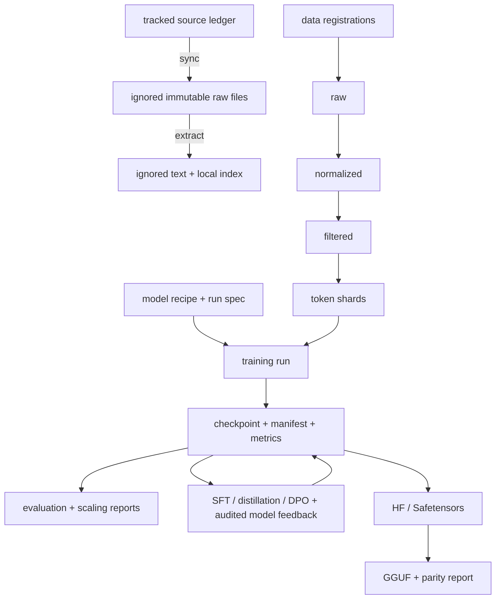

# Architecture

EPOR AI separates immutable evidence and artifacts from rebuildable indexes and
control state. v0.0.1 is deliberately a tiny, CPU-safe proof of the contracts
needed for later training; none of the target-family parameter counts represent
weights present in this repository.

## Model families

All model weights begin from independent random initialization. Teacher models
may provide licensed signals or synthetic data, but their parameters are never
copied, merged, or used as checkpoint initialization.

Families are listed alphabetically, and intended capability descends in the same
order: α is the flagship, γ the compact local model.

| Family                | Planned structure                                                                         | Parameter accounting                                  |                                Context target |
|-----------------------|-------------------------------------------------------------------------------------------|-------------------------------------------------------|----------------------------------------------:|
| EPOR-α (`epor-alpha`) | Shared plus fine-grained routed experts                                                   | ≈30B total; 6–8B active measured per token            |  256K configured; 8K local certification goal |
| EPOR-β (`epor-beta`)  | Dense RMSNorm/SwiGLU/GQA/RoPE decoder with backend-supported local/global attention       | 10–12B total and active                               | 256K configured; 16K local certification goal |
| EPOR-γ (`epor-gamma`) | Elastic dense decoder with nested slices; optional PLE and conditional-memory experiments | ≈8B total, ≈4B core resident path, optional ≈2B slice | 128K configured; 32K local certification goal |

Every recipe keeps these concepts separate:

- `configured_max_context`: the architecture/configuration ceiling.
- `trained_max_context`: the longest sequence length represented in training.
- `validated_max_context`: the longest length that passed the complete context
  evaluation gate.
- `operational_default_context`: a conservative default for a given runtime.
- certified profiles: results measured on an exact hardware/software tuple.

Accepting a tensor of a particular length updates none of the validation fields.

## Reference model

The canonical implementation is pure PyTorch. The v0.0.1 decoder provides
RMSNorm, SwiGLU, grouped-query attention, RoPE (with optional v0.0.8 scaling,
local windows, and a KV cache), causal masking, tied token
embeddings, deterministic initialization, and FP32 CPU execution. A generated
corpus and debug tokenizer make smoke tests network-free. Transformers is an
interoperability/export boundary, not the canonical training loop.

Target configurations may be constructed on PyTorch's `meta` device for
parameter accounting. Full parameter allocation or training is prohibited
without the compute gates in [COMPUTE_POLICY.md](COMPUTE_POLICY.md).

## Artifact flow

The ledger, registrations, recipes, and manifests are authoritative. SQLite is a rebuildable
query index. Raw research, datasets, run outputs, and weights stay ignored until
an explicit release process creates independently licensed artifacts.

## Provenance-first data engine

`epor.data` implements v0.0.3 as an offline, immutable pipeline under a private
data root. A strict source registration is written before acquisition. Raw files
are copied and hashed incrementally; normalized records retain parent and policy
hashes; rights failures and unsafe findings route to quarantine. Builds apply
removal tombstones and global exact/SimHash deduplication before a salted stable
family hash assigns splits. Filtered indexes, JSONL splits, manifests, and
dataset cards are immutable children rather than mutable views of a corpus.

Detectors retain finding kinds and counts, never the matched PII or credential
value in job events or reports. The rules are explicit proxy-scale heuristics
with human-audit and scale-revalidation requirements, not learned classifier or
malware-sandbox claims.

## Tokenizer and token shards

`epor.tokenizer` (v0.0.4) trains an original byte-level BPE from one build's
train split only, rewritten into a frozen layout: 256 reserved control IDs, one
ID per byte, then learned merges. Artifacts are content-addressed directories
whose manifest pins the reserved-spec hash, the tokenizer bytes, and the source
build, so IDs cannot drift silently. Token shards pin one tokenizer to one build
and store each split as little-endian `uint16` arrays framed by document
boundary tokens, with per-shard span indexes; they are staged and published
atomically and re-apply current removal tombstones. Fertility reports measure a
held-out split and fail their gate on any byte round-trip mismatch. See
[`TOKENIZER.md`](TOKENIZER.md); every artifact so far is proxy-scale.

## Research archive safety

The research synchronizer accepts only URLs already present in the validated
catalog. It enforces HTTPS, exact allowlisted hosts, bounded redirects,
content-type and byte limits, transfer-byte hashing, file signatures, atomic
replacement, path containment, and optional offline operation. Immutable
artifacts use raw-byte pins. Explicitly reviewed dynamic HTML sources instead
pin normalized document or semantic-article text under a versioned profile while
recording every raw transfer digest in ignored metadata. The control API keeps
observed raw, tracked raw, and tracked content digests distinct. A digest
observed only during local synchronization is `unpinned`; only a raw or
normalized-content digest in the reviewed tracked ledger can produce `verified`
status.

## Training and scale-out

The single-process loop remains the correctness oracle. The v0.0.5 training
kernel (`epor.training.kernel`) trains on verified token shards with packed,
token-budgeted batches, AdamW with warmup and cosine decay, BF16 autocast,
accumulation, activation checkpointing, and DDP or FSDP2 over CPU `gloo`. Loss
is normalized by the global step's target tokens, so gradients are independent
of world size and accumulation. Checkpoints go through
`torch.distributed.checkpoint` and are hashed and promoted atomically, so one
topology's checkpoint resumes exactly under another; the data cursor and RNG are
part of every checkpoint. Local multi-rank runs rendezvous through a private
file store with sockets pinned to loopback. See [`TRAINING.md`](TRAINING.md)
for the exact-resume contract, what agrees bitwise and what within tolerance,
and the limitations. Provider-specific CUDA, ROCm, JAX, Triton, and Hopper
stacks live in separate locked environments.

The executable v0.0.1 reference path shares one allocation-free policy across
the CLI and control worker. It rejects non-reference or over-50M recipes before
model construction, caps the in-memory corpus and trusted checkpoint before
loading, and bounds steps, evaluation batches, and batch tokens. Direct CLI
paths additionally remain under `EPOR_PROJECT_ROOT`; target-family recipes are
metadata/meta-device planning inputs and cannot enter this runtime. The
kernel has its own bounds (dense only, at most 50M parameters, 100,000 steps,
and 1,048,576 tokens per step) and never resizes a shipped recipe: training on a
tokenized build's vocabulary uses an explicitly derived config with its own
hash.

The reference RX 5700 XT is an inference target through llama.cpp/Vulkan with a
CPU fallback. It is not a required PyTorch training device.

## Evaluation and scaling laboratory

The v0.0.6 harness (`epor.evaluation`) scores a kernel checkpoint on versioned
suites — multiple choice with calibration, exact match, `eval`-free math
equivalence, sandboxed code, validation loss, contamination, memorization, and
the G10 model-behaviour items — and seals a content-addressed report whose
every metric carries a `harness-fixture` or `proxy-scale` scope. External
benchmarks enter only as operator-registered local files. Model-generated code
runs only in a defense-in-depth subprocess sandbox, only from the owner's CLI,
and only under its own covenant action. The scaling laboratory
(`epor.scaling`) profiles this host, runs resumable sweeps and mixture
ablations through the training kernel, fits scaling-law forms, and projects
target runs from operator inputs; rungs above the kernel's bound are
projection-only and a projection is never an approval. Reports of both kinds
live under the private data root and are re-verified whenever they are read.
See [`EVALUATION.md`](EVALUATION.md) and [`SCALING.md`](SCALING.md).

## Knowledge transfer and alignment

The v0.0.7 pipeline (`epor.alignment`) adds the `epor-chat-v1` format on the
frozen reserved role and turn IDs, with assistant-only targets, and keeps all
alignment material as immutable provenance records under the data root:
generator identity, rights and cost basis, prompt-template hash, sampling,
time, exact output, and lineage, with data-engine tombstones propagating
through lineage. SFT and logit distillation run inside the training kernel
through optional settings that stay out of the trajectory hash at their
defaults, so single-process, DDP, and FSDP2 runs and exact resume carry over.
DPO is a single-process baseline against a frozen reference, using kernel
checkpoints. Critique and revision cite covenant obligations by key, read
from the covenant file. AI judge decisions and model-written evaluation items
are candidates that reach training only through a judging run whose sampled
accepted and rejected decisions a verified human has audited, within a
disagreement threshold. The audit queue is a hash-chained log under the
safety root. Overoptimization monitors and the model-level G10 comparison
store content-addressed reports. See [`ALIGNMENT.md`](ALIGNMENT.md).

## Context laboratory

The v0.0.8 mechanisms are optional config fields that are hash-neutral at
their defaults: RoPE scaling (linear, NTK, YaRN), a separate RoPE base for
local layers, interleaved local/global attention with a bounded window, an
experimental MLA variant, and an experimental sparse-attention retrofit. The
reference decoder gains a KV cache for prefill and incremental decode, with
a bounded ring for local layers and optional int8 storage. `epor.context`
extends checkpoints in the kernel, generates and scores the G6 suite,
measures host profiles in memory-capped subprocesses, runs sweeps, and
projects the 32K/128K/256K recipe. Configured, trained, and validated context
stay three separate numbers; only a certificate from a passing G6 report
raises validated context. See [`CONTEXT.md`](CONTEXT.md).

## Local control plane

The API, worker, and UI are separate processes. Typed job specifications include
the original probe/research/reference-training jobs, v0.0.3's `data_ingest`,
`data_build`, `data_remove`, and `data_audit`, v0.0.4's `tokenizer_train`,
`tokenizer_shard`, and `tokenizer_evaluate`, v0.0.5's single-process
`kernel_train` and `kernel_evaluate`, v0.0.6's `eval_suite`,
`eval_contamination`, `scale_profile`, `scale_sweep`, and `scale_mixture`, and
v0.0.7's `align_generate`, `align_judge`, `align_dataset`, `align_sft`,
`align_preference`, and `align_evaluate`. Running model-generated code,
registering teacher material, and recording human audit verdicts are
deliberately not job types; fits and projections stay on the CLI. A verdict is
recorded by a verified human through `POST /api/v1/alignment/audits/{id}/verdict`
or the CLI, gated by the `align_audit` action. The API never evaluates a client command, fetches
an arbitrary data URL, or exposes a general filesystem browser. Job results
carry a report ID and a small fixed summary; full evaluation and scaling
reports are served by read-only endpoints that verify each content address.

Admission is the covenant chokepoint. `JobService.create_job` resolves the
requested action — still a plain string at that point — against
`configs/covenant-v1.yaml` through `epor.actions` before converting it to a job
type or parsing its specification, records the verdict and covenant hash in the
append-only event stream, and raises rather than queueing anything the covenant
does not permit. The worker re-resolves at dispatch so a job admitted under an
earlier covenant cannot execute under a later one. The CLI shares that registry
rather than keeping its own, through a single command-to-action table, so
`doctor`, `config validate`, `research sync|verify|index`, `data
ingest|build|remove|audit`, `tokenizer train|shard|evaluate`, `train
pretrain|resume|kernel|kernel-resume`, `eval run|kernel|suite|contamination|compare|reports`,
`scale ladder|profile|sweep|mixture|fit|project|reports`, `train sft|preference`,
`align fixtures|teacher|source|critique|eval-items|judge|dataset|audit|monitor|g10|reports`,
and `generate` are governed identically despite
never touching the control plane. They also share the reference-runtime limits
described above, so the declaration's resource assumptions hold on either
route. Stopping work is never gated: the second principle outranks the third,
so cancellation, correction, and shutdown bypass the gate by design.

Identity is part of that resolution rather than a check beside it.
`epor.control.authority` holds one owner and any number of expiring, scoped
delegated operators in a hash-chained log under a private `0700` directory, and
`resolve_action` folds the requesting actor into the second principle's
assessment. An unverified or out-of-scope request therefore becomes a Principle
2 conflict with nothing higher-ranked to justify it, which the existing
ordering refuses — and which no Principle 3 argument about availability can
talk past. Every `GET` remains anonymous. When the covenant escalates instead
of deciding, no job is created and a sanitized escalation is opened carrying
only a digest of the request; an owner approval binds one actor, one digest,
and one covenant hash, expires in fifteen minutes, and is consumed exactly once
under an exclusive file lock. The `principals`, `escalations`, and
`authority_events` tables are a rebuildable index over that log, never a source
of authority.

Jobs use compare-and-set transitions and append-only events. File manifests are
the durable artifact truth; the loopback SQLite database uses WAL mode for local
coordination and can be rebuilt. The server binds to `127.0.0.1`, uses explicit
origins, redacts secrets, and resolves all artifact paths under configured roots.

`/api/v1/documents` serves the project's own tracked Markdown to the console
reader. It is not the filesystem browser the previous paragraph rules out: the
index is built by globbing two fixed first-party locations, and a request is
answered by exact slug lookup inside that index, so no caller-supplied value is
ever joined onto a path. Ignored third-party research downloads are excluded on
purpose — rendering unreviewed external text as console content would make it a
new instruction surface. The reader escapes raw HTML and drops every link scheme
except `http`, `https`, and `mailto`.

## Release boundaries

A release checkpoint consists of sharded Safetensors, configs, tokenizer and
chat format, model card, manifest lineage, data/tokenizer/code hashes, license,
benchmark report, and signed checksums. Quantized derivatives additionally pin
the converter and llama.cpp revisions and report quality drift plus measured
RAM, VRAM, TTFT, and throughput.

See [ROADMAP.md](ROADMAP.md) for gates and
[DATA_GOVERNANCE.md](DATA_GOVERNANCE.md) for rights and lineage policy.
